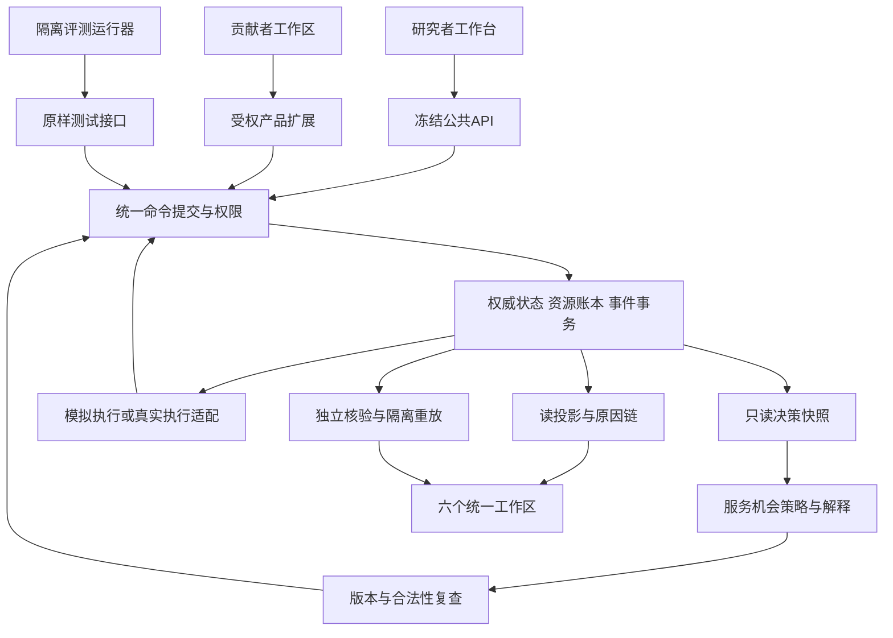

# 织算 Campus Fabric：终态产品与独立复审

2026-11-14 · 产品定义V2 · 从成品反推实施

本版依据正式`challenge.md`、冻结OpenAPI及新增选手补充说明，从零重新审题，再审查上一版分析。评分仍按用户确认的ZIP：55分基础可靠性＋45分创新与工程证据。补充说明是题意解释，不改写正式契约。本轮交付的是可直接进入开发的产品定义、技术主线与协作规格；下列成品能力和数字均为目标，尚未实现或测得。

## 1. 定格最终产品

**产品名称：织算 Campus Fabric。**

**定位：让校园中的临时GPU供给，成为可以申请、收回、接续和追问的共享计算服务。**

交付形态是一套有正式Web工作台、完整HTTP Server、可信运行内核、服务调度、事件回放和实验中心的应用。研究者、贡献者和管理员都能完成自己的核心工作；评委可以临时改变资源、请求和故障，看到系统按相同规则继续运行。

我们现在就确定四项产品承诺：

1. **资源归属清楚。** 谁在什么期限内持有什么、到期或收回后如何归还，都能逐笔核对。
2. **任务身份连续。** 中断、等待、重试和恢复属于同一项用户工作；不会用换ID掩盖损失。
3. **决定有依据。** 为什么等待、为什么选这张卡、为什么不能恢复，能查到当时的约束和实际决策。
4. **效果可复验。** 同一资源和事件下，主策略、合理基线及消融的得失可以重新计算。

这四项共同构成一条主线：**把一次资源借用做成可兑现、可解释、可持续接续的服务。** 六个工作区是这条服务的不同视角，不是六个独立项目。

### 一次完整的成品体验

研究者选择任务配方或输入image/command，填写资源、租约与恢复偏好。系统展示当前可行性和条件化的运行计划。提交后先创建allocation，再在它上面提交job；如果第二步失败，页面明确显示仍然存在的租约及释放/重试动作。

贡献者从“我的资源”发起合法收回。研究者收到截止时间，任务详情展示快照报告、可核验工件及恢复预算。资源按规则归还；无替代资源时，任务保持同一身份并解释缺少的条件。条件满足后，合法恢复继续执行。

工作最终到达**结算卡**：成功时取得结果、日志和执行历史；失败时取得原因、最后有效保存点、已耗预算及后续可选动作。卡片明确租约仍保留还是已经归还。纯规范调用不暗中改变租约语义；产品的自动归还需用户明确选择，并确认没有其他工作仍使用该租约。浏览器关闭也不会让已接受的自动归还流程丢失。

管理员沿这次事件看到请求、决策快照、占用变化、执行代次和最终结果；还可以把事故复制到隔离实验，换一个策略或输入，比较另一种处理的代价。所有画面来自实际服务行为。

## 2. 上一版应该保留什么、纠正什么

上一版对接口、信息权限、资源守恒和证据边界的多数判断成立。需要重构的是开发组织及最终品质，而非重新否定全部分析。

| 上一版安排 | 此次审查 | 新安排 |
|---|---|---|
| 前半程几乎只做底座，13小时后才研究创新 | 创新依赖的决策记录和数据接口可能来不及补 | 从第一小时建立正式决策对象、基线和实验入口 |
| 界面与呈现集中到17小时以后 | 用户流程被降为后台完成后的装饰 | 借用、贡献、恢复和解释从开工就进入正式产品 |
| 一人内核，另一人测试/文档/界面 | 第二人缺少连续技术主线，也容易成为杂务中心 | A拥有可信执行，B拥有决策与体验；双方承担自己的验证与文档 |
| 到时间点自动取消目标、冻结功能 | 时钟替代了产品验收，容易过早降低成品标准 | checkpoint确认完成度和阻断缺陷；通过局部修复保持终态与接口稳定 |
| 轻量内核被理解成小型原型 | 架构成本与产品品质混淆 | 单一事务内核也建设持久事件、精细交互、完整实验与实际执行适配 |
| 贡献者操作直接画进冻结API | 冻结API没有普通贡献者登记/收回入口 | 增加受权限控制的独立产品扩展，和`/_test`严格隔离 |

**仍然保留**：原文件不改、一个权威账本、逻辑时间、无未来信息、真实配对、未完成样本和个体损害、模拟/实测区分。这些要求让高目标站得住，并不要求功能少或体验简陋。

## 3. 从题目重新选择竞争方向

独立比较了三个完整成品方向：

| 方向 | 主要竞争力 | 最容易被击中的弱点 | 取舍 |
|---|---|---|---|
| 完整GPU资源门户 | 供需信息和自助借用清晰 | 只是把群聊借卡换成表单，恢复与机制证据不足 | 纳入基本体验 |
| 高性能调度研究平台 | 同条件下减少等待或损失 | 模拟模型制造优势，用户仍看不懂失败 | 纳入技术主线，强制合理基线 |
| 可解释的共享计算控制台 | 从承诺到执行到异常都有证据，可实际处置 | 容易只剩漂亮日志界面 | 作为终态骨架，接入真实决策和执行 |

最终选择：**可解释控制台承载服务机会调度，并用真实的回收恢复流程证明价值。**

核心技术命题是：在履行资源契约的前提下，减少对稀缺兼容机会的浪费和无效恢复，改善各Owner获得的有效服务。解释能力记录这个机制实际作出的决定；它不是事后生成的宣传文案。

成品形态、接口和验收目标在开工前固定。具体策略是否优于基线，由实验决定。若某个启发式失败，可以在相同策略接口中修正或关闭它，不需要推翻应用、事件模型和用户旅程。

## 4. 六个正式工作区

统一对象、角色、时间与视觉体系。页面可使用主导航加详情抽屉实现，不要求六套独立前端工程。

| 工作区 | 成品应该让用户完成什么 | 必须接到的真实行为 |
|---|---|---|
| **运行工作台** | 按需处理等待、执行、中断和需人工操作的任务；从配方或原始image/command提交 | allocation→job两阶段提交、续租、取消、恢复；明确部分成功 |
| **资源与贡献** | 看型号/显存/profile与剩余形状；登记模拟供给、开放或收回自有资源 | 真实库存与持有记录；贡献者扩展鉴权；归还回执 |
| **任务连续性** | 查看同一工作历次attempt、保存点和预算，领取结果或失败结算卡 | 真实job/allocation关联、checkpoint报告、工件、执行代次和租约最终处理 |
| **决策解释** | 查询为何等待、为何被选/未选、当前改变什么才可能可行 | 决策时快照、完整硬约束检查、实际候选排序、条件化下一步 |
| **事件与实验** | 重放事故；在隔离run内比较基线、候选与消融；查看个体得失 | 通用回放器、独立输入种子、同模型实验、原始数据导出 |
| **系统验收** | 查看契约覆盖、不变量、失败历史、构建身份和复现入口 | 真正执行的验收记录；未运行项明确显示待测 |

### 任务详情是一屏完成度的标尺

顶部用一句话回答“现在怎样、下一步能做什么”。例如：“资源已归还；当前没有符合20GiB要求的空闲设备；已收到第480步快照报告，还可尝试恢复1次。”只有工件验证完成，才显示“已核验保存点”。

中部左侧为事件/attempt时间线，右侧为资源位置、租约和合法操作；底部展开候选排除、请求回执及资源变化。用户不需要理解锁或数据库才能操作，管理员又能追到完整证据。

运行预测用虚线，已发生事实用实线；承诺与估计、逻辑时间与墙钟时间、模拟与实际执行都有稳定标签。不会把无依据的恢复ETA伪装成确定倒计时。

### 视觉标准

采用紧凑的专业运维界面：浅灰底、深色文字、蓝绿主色，琥珀表示等待/风险，红色只表示失败或紧急状态。每屏一个主要决策任务，避免巨型数字卡堆满首屏。表格、时间轴和资源形状视图共享密度、单位、图例与间距；空态、加载、部分成功和失败反馈与正常页面同样完整。

主要操作在1440×900桌面视口无需横向滚动；关键状态不能只靠颜色区分。复制请求、定位事件、导出证据应从对应对象直接进入。外观精致和信息诚实同时验收。

## 5. 从成熟产品借什么

检索日期2026-11-14；以下是产品与机制借鉴，不代表兼容这些平台或继承其性能。

| 一手对标 | 借入织算的具体做法 | 需要自己解决的本题问题 |
|---|---|---|
| [SkyPilot Managed Jobs](https://docs.skypilot.ai/en/latest/examples/managed-jobs.html) | 围绕稳定job身份管理失败、恢复和日志，用户持续追踪同一工作 | allocation租约、贡献者回收、两类重试预算；重新启动不自动代表从快照继续 |
| [Run:ai Scheduler](https://run-ai-docs.nvidia.com/self-hosted/platform-management/runai-scheduler/scheduling/how-the-scheduler-works) | 区分份额、借用与优先级，将调度顺序和资源归属表达清楚 | 多Owner与可撤回供给；自定义规则不能照搬其公平性保证 |
| [dstack Runs API](https://dstack.ai/docs/reference/http/runs/) | 资源、配置、运行计划与任务生命周期保持连贯 | 不要求用户安装特殊客户端才能调用基础API |
| [Modal Preemption](https://modal.com/docs/guide/preemption)、[Volumes](https://modal.com/docs/guide/volumes) | 明确应用状态、持久数据与执行环境边界 | 不能把任意GPU程序的恢复当成平台自动具备的能力 |
| [Kueue Fair Sharing](https://kueue.sigs.k8s.io/docs/concepts/fair_sharing/) | 有条件的借用、公平准入以及避免反复互抢的设计意识 | 贡献者回收不服从我们的公平保护；改动模型后重新检验循环 |
| [Slurm Preemption](https://slurm.schedmd.com/preempt.html) | 通知期、停止、重排和资源释放分清楚 | 挂起不一定释放全部资源；本题状态和逻辑时钟仍由自己实现 |

这些产品共同提示：成熟性体现在完整工作流、失败行为和可追问的状态，而非菜单数量。相近竞赛也提供了有用参照：[SC26 Student Cluster Competition](https://sc26.supercomputing.org/students/student-cluster-competition/)强调可运营的集群准备和来源/构建证据；[AI Infrastructure课程Hackathon](https://mlsys.github.io/hackathon/2/)强调同条件有效工作与独立评测。它们各自的硬件、团队和时限规则不移植到本题。

## 6. 技术主线：合同约束下的服务机会调度

### 6.1 三个决策层

1. **合法性层**：资源、型号、显存、profile、标签、Owner、租约、回收占用与预算。所有策略共享同一合法性检查。
2. **服务选择层**：根据配置的Owner份额、请求priority与已观察等待选择本轮需求。可借用加权公平准入、老化和明确的同分规则；不宣称获得一般DRF定理。
3. **放置与恢复层**：在合法候选中尽量保留其他已知需求的兼容机会；对已知job的恢复，再考虑已保存状态、恢复代价和公开回收期限。缺少工期/profile时使用不依赖这些信息的规则。

JobRequest没有duration，allocation创建时甚至可能还没有job。因而准入/放置不能偷看未来job，timeout也不能当运行时长。高级工作量描述可以来自可选配方和声明的性能profile；纯规范客户端不提供它们时仍然获得完整服务。请求中的MIG-like profile则始终是必须遵守的资源约束，与性能profile不同。

### 6.2 一个候选定义及已经发现的失败边界

在当时状态 \(S\) 中，令 \(\mathcal F_b(S)\) 为已排队请求b的合法放置集合。候选动作x占用资源后可用状态记作 \(S\ominus x\)。一种当前机会损失代理为

\[
\Omega(x;S)=\sum_{b\in Q\setminus\{a\}}w_b\,
\mathbf1\{\mathcal F_b(S)\ne\varnothing,\ \mathcal F_b(S\ominus x)=\varnothing\}.
\]

它仅衡量已选请求a的一种合法放置，会让多少加权的已知需求从“当前可放”变成“当前不可放”。比较候选时固定同一全队列快照。权重需要按Owner与请求类别明确，不能让简单拆分请求无限增加权重。也可按相同资源形状聚合计算，降低成本。

独立攻击已经发现两个关键反例：在即时分配的稳定时刻，原有Pending请求通常都当前不可行，因此新申请到达时，所有放置的\(\Omega\)都可能为0；大请求需要两张卡、当前只空一张时，小请求吃掉这张卡，也不会改变大请求的二元可行性。因此这个候选只有在释放/恢复让多个请求同时可行等时点才可能产生信号，不能宣称已经保护了部分可行的大任务或解决饥饿。

**据此不把这一公式冻结为主算法。** 保留它作为可解释的受限候选和反例测试；实验必须报告它的非零覆盖率、触发时机和实际决定变化。正式策略接口允许使用成熟的稀缺性放置、兼容余量或有依据的预约机制；哪些进入主策略由同条件证据决定。冻结的是产品能力和决策层次，不是一个已知会失效的打分式。

该量是局部代理，没有把未来最优JCT藏进定义，也不证明未来服务必然改善。反例必须包含：为罕见大任务保留稀缺卡却使大量短任务等待、所有供给稳定、当前队列与后来到达需求相反。若代理不能超过合理基线，保留结果并换同一层中的候选规则，完整产品不受影响。

### 6.3 恢复成本只在已知信息下使用

对已经出现的job，可以区分恢复等待、加载时间、未保存工作和剩余预算。短可用窗口是否值得利用，还需区分“能直接完成的小任务”和“必须再保存才能留下进度的长任务”。已知通知期限是可用信息，评估器中的未来回收时间不是。

不把稳定性预测作为默认必须依赖。若以后加入历史预测，预测错误只影响策略质量，不能破坏资源守恒、Owner权限或贡献者deadline。

### 6.4 实际决策本身成为产品对象

每次重要决定同时记录：信息截止、候选、排除约束、实际选择、同分规则、提交版本、资源变化、影响的allocation/job/attempt以及下一次需要的条件。前端读取这份记录，不根据事后状态猜理由。

若当前没有合法放置，解释必须覆盖完整合法放置域，或者提供该域上完备的不可行证据。对完整有限候选集，每个候选至少有一个可核对的违反约束，才能说“当前不可行”。仅检查top-k全部失败，只能报告“已检查候选不可行”，不能声称全池没有资源。这不是对未来不可行或全局最优性的证明。

这个decision对象连接机制、界面和实验，是我们相对“普通调度器加监控页”最应做深的部分。

## 7. 正式架构与扩展边界

推荐起点：Python领域/服务层，成熟HTTP与校验组件，单一事务状态内核，SQLite事务存储与持久事件；TypeScript Web工作台与统一API客户端。锁定依赖并准备本地一键启动及容器构建。使用熟悉的等价栈也可，但CP0后不因个人喜好整体换栈。

单写者解决提交一致性，复杂计划和读投影可以在不可变快照上计算。提交前校验版本，失效计划不得扣资源。状态与事件在同一事务中落地；进程重启恢复是本产品自定的高质量要求，不能靠仅有内存状态冒充。

正式成品还包括一项**真实CPU参考任务**的保存、停止、恢复与结果一致性验证。它与评测所用的逻辑时间模拟执行分模式运行：CPU实际运行时间不能被clock瞬间推进；CPU证据也不证明CUDA执行、显存隔离或GPU吞吐。这样既有可检查的真实软件执行链，又不让GPU设备成为完成全部产品流程的前提。

### 必须从第一天避免的接口错位

- 普通贡献者登记、开放和收回使用自有扩展，例如`/x/v1/contributions/*`。鉴权后进入同一领域命令；普通用户不能获取X-Test-Key。
- `/_test`继续原样用于受控评测，不能包装成普通贡献者产品按钮。实验区与运营实例/用户权限隔离。
- “提交工作”可以是UI编排，但底层仍是先allocation后job。job提交失败要显示已有租约，不静默反复创建租约。
- checkpoint的`ready`报告、工件可读取验证、应用成功恢复三者分别表示。允许没有artifact_uri的规范请求，不因此伪造已经验证的文件。
- 全局运营视图使用管理员扩展；普通events/metrics/list继续保持caller隔离。
- 事实、重放和修改输入后的分支实验有不同run身份；未来分支永远不能污染在线调度信息。

## 8. 把目标提高到值得争取的高度

下面是团队自定目标，不是官方阈值，更不是当前成绩。正式评测环境公布后记录硬件与限额，再验证同一目标；不能事后挑选有利机器而混报。

| 层次 | 目标 |
|---|---|
| 正式成品标准 | 全部21个操作与三角色流程真实可用；六个工作区闭环；控制面持久化重启恢复；一项真实CPU参考任务完成可恢复执行与结果核对 |
| 可靠性标准 | 冲突申请、重试、回收、过期、失效和reset组合历史中，超卖、越权、重复效果、幽灵占用、虚假恢复和预算越界均为0 |
| 证据标准 | 每个调度/恢复决定有实际decision记录；重放与账本可独立核对；没有仅在前端存在的状态 |
| 效果争取目标 | 在03固定的五类场景集（含中性/反向场景），相对下述B2合理基线，未兑现需求面积宏平均降低至少15%；每个配对run完成数不下降；无新增超阈值受损job/Owner。逐场景列结果 |
| 规模争取目标 | 合成128节点、1,024物理GPU、64 Owner、10,000逻辑任务；处理50,000条混合命令、32并发请求，核验保持一致 |
| 交互争取目标 | 在明确4 vCPU/8GiB参考环境与声明负载下，普通查询/命令p95小于200ms；不把故障注入延迟、批量clock推进或实验任务混入该延迟口径 |
| 体验标准 | 新用户能完成提交、理解等待、续租/取消/恢复；贡献者能收回并看回执；主要流程无假按钮，1440×900布局协调 |
| 高难冲刺 | 大规模组合故障自动缩减为可复现的更小反例；跨主机/多worker恢复与失联隔离；可执行K8s/KWOK或实GPU适配证据。单CPU参考子进程在控制面重启后的确认与隔离已属正式目标 |

**基线在实验前锁定。** B0为FIFO＋first-fit；B1为与候选相同的Owner公平规则＋best-fit；B2在B1上加入简单的兼容稀缺性优先放置。三者都具备相同的正确回收、保存与有界恢复能力。主策略P分别关闭机会损失项、恢复代价项作消融，不以只胜过B0作为充分创新证据。

**服务时间从逻辑工作到达开始。** 对封存输入中的工作i，\(r_i\)是固定的请求/意图到达时刻，不能改为allocation获准或job实际创建的时刻；跨策略相同。令完成时刻为\(C_i^\pi\)，未完成或执行失败取无穷，则

\[
F^\pi(H)=\sum_{i:r_i\le H}\bigl(\min(C_i^\pi,H)-r_i\bigr).
\]

allocation被拒、排队、job提交失败都不会让该工作从评估中消失。否则“等租约100秒再运行10秒”会被错误记成10秒，胜过“立即运行20秒”。普通API客户未提供完整工作意图时，产品分开报告allocation等待与job生命周期，不杜撰其意图到达；主要配对实验由共同输入明确记录工作身份和到达。主动取消的处理提前固定，不能由策略选择性取消困难工作改善分数。

对每个预定场景族，先平均其种子上的\(F_P/F_{B2}\)，再对场景族等权平均，目标为\(R\le0.85\)。\(F_{B2}=0\)的run另报绝对退化，若候选变差也不能被比例筛选隐藏。

个体损害定义为\(\Delta T_i=\min(C_i^P,H)-\min(C_i^{B2},H)\)，覆盖失败和未完成。暂定严重损害门槛为\(\Delta T_i>300\)逻辑秒；Owner在同单位、同窗口下有效服务低于基线的80%也计为严重损害，仅在基线服务为正时算比例，零基线另报绝对量。所有阈值在最终验证集运行前固定，并展示完整差值，而非只报过线数量。

这些都是争取目标。效率和伤害约束若不能同时达到，应交付取舍与经过核验的策略，不改阈值来宣布完成。有效服务单位来自声明模型，不将合成GPU吞吐说成实测。

高难目标从接口设计时预留、可并行推进。真实执行、K8s和GPU的价值由能提供的证据决定；无需为了显得庞大同时把所有框架引入核心。

## 9. 三路独立审阅与交叉攻击后的关键修正

| 攻击 | 如果不改会发生什么 | 终态中已加入的回答 |
|---|---|---|
| “这只是普通调度加漂亮页面” | 六个菜单没有机制增量 | 机会损失与恢复成本的明确决策对象、合理基线、消融和局部证据 |
| “贡献者按钮调用测试后门” | 产品授权和评测隔离失效 | 独立贡献者扩展，同一命令内核，不暴露测试密钥 |
| “租约成功、job失败后怎么办” | 重复租约或无法解释的空占用 | 两阶段提交回执、可重试job与显式释放租约 |
| “无工期的客户端还能用吗” | 核心接口实际依赖额外隐藏字段 | 无profile仍合法调度；增强元数据单独评测 |
| “解释是事后编的吗” | 并发后快照已经变化，解释错误 | 决策时版本、候选与排除证据随提交记录 |
| “恢复快只是虚构GPU速度吧” | 模型偏置冒充算法创新 | 同模型配对，参数来源，CPU/模拟/GPU证据分级 |
| “时间线回放就是播放动画吗” | 不能检验另一种决策 | 从封存输入运行同一通用内核，隔离分支与不可变原始run |
| “故障数量多就是可靠性证明吗” | 同一错误引擎自证正确 | 独立小参考模型、黑盒观察、交错和变形检查；数量只是覆盖目标 |
| “高目标导致A做一切，B到处补洞” | 交汇前集成债务巨大 | 两条等价值主线，写命令/读投影/策略接口冻结，各自自测与文档 |
| “checkpoint一到就重开方向” | 深度工作被会议和架构变更打断 | 4—6小时连续区块，固定交汇时刻、预跑验收、只处理跨边界阻断 |

## 10. 最终应当让评委记住什么

评委应当看到一项真正可使用的校园算力服务：设备可以临时共享，主人能拿回，借用者看得懂中断并能接续；每个决定能追问，每笔资源能核对，效果能在陌生场景下重新比较。

从第一小时开始，大家建设的就是这个最终产品。内部的小测试、基线和反例是完成它的质量工具，不再用来不断缩小终态或制作互不相干的演示。

后续开发顺序和checkpoint见[双人正向开发作战书](02_双人24小时正向开发作战书.md)，稳定交汇接口与严苛验收见[交汇契约与验收规格](03_交汇契约与验收规格.md)。
